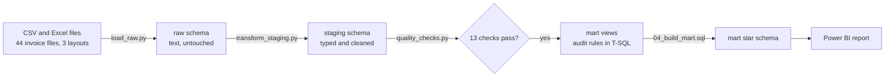

# Freight Invoice Audit

An end-to-end data pipeline that audits freight carrier invoices against shipment records, contract rate cards and approved extra charges, then reports the billing errors in Power BI.

**Stack:** Python (pandas, SQLAlchemy) · SQL Server (T-SQL) · Power BI (DAX) · Excel and CSV sources

## Result

| Measure | Value |
|---|---|
| Invoice lines audited | 5,076 |
| Total billed | $30,338,069 |
| Lines with a billing error | 555 (10.93%) |
| Recoverable amount | $906,827 (2.99% of billed) |
| Planted errors detected | 555 of 555, with no false alarms |

Two findings stand out:

- **Duplicates cost the most.** Duplicate invoices and shipments billed twice are 76 lines but $417K, 46% of the recoverable amount, because the whole invoice is recoverable.
- **Overcharges are the most frequent.** Rate, weight and fuel overcharges are 364 lines but $341K, because only the excess over the contract price is recoverable.

## Dashboard

**Executive Summary**


**Findings Detail**


## About the data

All data in this repository is **synthetic**. It is generated by `etl/generate_data.py` with a fixed random seed, so every run produces identical files. No real company, customer, carrier or invoice data is used.

The generator creates 5,000 shipments across 6 fictional carriers (air, ocean and road) and plants 555 billing errors of 7 types, plus deliberate data-quality problems. The planted errors are recorded in an answer key that the audit never reads; it is used only to score the result.

## Architecture



| Layer | Purpose |
|---|---|
| `raw` | A faithful copy of each source file. Every value is text; every row records its source file and load time. |
| `staging` | Clean, typed tables. Junk is removed; suspicious rows are kept and flagged. |
| `mart` | Audit views and the star schema that Power BI reads. |

## What the pipeline handles

**Three invoice layouts.** Each carrier names its columns differently, writes dates differently (`02/28/2026`, `2026-02-28`, `28-Feb-26`), and one layout puts title rows above the header. The loader detects the layout from the header row instead of relying on file names.

**Dirty values.** Money stored as text (`$1,234.56`), shipment references with stray spaces or lowercase letters, blank weights, TOTAL rows at the bottom of files, and duplicate rows in the shipment export.

**Junk versus evidence.** A TOTAL row is junk and is removed. A duplicate invoice is evidence and is kept and flagged. Deleting it would hide the finding.

**Fail loudly.** If a value cannot be converted, the transform stops and names the column and an example value. Bad data is never loaded silently.

## Data quality checks

`etl/quality_checks.py` runs 13 checks on every run, saves the results to `staging.dq_results`, and exits with an error if any check fails.

| Category | Examples |
|---|---|
| Completeness | Row counts reconcile between raw and staging; invoice amounts reconcile to the carriers' own statement totals ($7,543,451.60, zero variance) |
| Uniqueness | Shipment IDs and invoice line IDs are unique |
| Validity | Line items add up to the invoice total; no negative amounts; dates in range |
| Consistency | Every carrier is known; every shipment has a rate card covering its ship date; rate periods do not overlap |

## Audit rules

Each rule compares the invoice with an independent fact. Rules are written in T-SQL in `sql/02_v_invoice_audit.sql`.

| Finding | Rule | Lines | Recoverable |
|---|---|---|---|
| Shipment billed twice | Same shipment billed again under a new invoice number (`DENSE_RANK`) | 36 | $209,716 |
| Duplicate invoice | The invoice number has been received before | 40 | $207,578 |
| Billed weight too high | Billed weight more than 2% above shipped weight | 129 | $177,144 |
| Rate above contract | Linehaul more than 1% above the rate card for the ship date | 149 | $140,123 |
| Shipment not found | No matching shipment record | 24 | $129,110 |
| Fuel surcharge too high | Fuel more than 1% above the agreed percentage | 86 | $23,630 |
| Unapproved extra charge | Accessorial billed with no approval on file | 91 | $19,526 |
| **Total** | | **555** | **$906,827** |

Rate cards change over time, so each shipment is matched to the rate that was valid on its ship date. Tolerances absorb rounding and normal scale differences.

## How to run it

Requirements: Python 3.12+, SQL Server with ODBC Driver 18, Power BI Desktop.

```bash
# 1. Create the database and schemas
#    Run sql/00_create_database.sql in SSMS or the VS Code MSSQL extension

# 2. Set up Python
python -m venv .venv
.venv\Scripts\activate
pip install -r requirements.txt

# 3. Run the pipeline
python etl/generate_data.py        # create the synthetic source files
python etl/load_raw.py             # load files into the raw schema
python etl/transform_staging.py    # clean and type into staging
python etl/quality_checks.py       # 13 checks must pass
python etl/load_answer_key.py      # load the answer key for scoring

# 4. Run the SQL scripts in order
#    01_v_invoice_enriched.sql, 02_v_invoice_audit.sql, 04_build_mart.sql
#    03_audit_scorecard.sql and 05_findings_summary.sql report the results

# 5. Open powerbi/freight_invoice_audit.pbix and refresh
```

The connection in `etl/db.py` uses Windows authentication against `localhost`, so no password is stored in the repository.

## Repository structure

```
data/
  raw/           source files produced by the generator
  answer_key/    planted errors, used only for scoring
etl/
  db.py                  SQL Server connection
  generate_data.py       synthetic data generator
  load_raw.py            extract and load into raw
  transform_staging.py   clean and type into staging
  quality_checks.py      automated data quality checks
  load_answer_key.py     load the answer key
sql/
  00_create_database.sql   database and schemas
  01_v_invoice_enriched.sql  invoice joined to shipment, rate and approval
  02_v_invoice_audit.sql     audit rules
  03_audit_scorecard.sql     audit result versus answer key
  04_build_mart.sql          star schema for Power BI
  05_findings_summary.sql    headline result
powerbi/
  freight_invoice_audit.pbix
docs/
  dashboard screenshots
```

## Limitations

- **The 100% detection rate reflects clean synthetic errors.** The errors were planted by a script and each invoice has at most one. Real carrier billing is messier: partial credits, disputed weights, rates agreed by email, and several problems on one invoice. On real data these rules would be a starting point, with findings reviewed before any dispute is raised.
- **Tolerances are assumptions.** The 1% and 2% thresholds are reasonable defaults, not negotiated contract terms.
- **Full reload.** Each run replaces the tables. A production version would load new files incrementally.
- **Windows Smart App Control.** On Windows 11, Smart App Control can block SQLAlchemy's compiled extension. Installing the pure-Python build avoids it: `set DISABLE_SQLALCHEMY_CEXT=1` then `pip install --force-reinstall --no-deps --no-binary sqlalchemy sqlalchemy`.

## Author

Marwan Harbi · [github.com/marwanmharbi](https://github.com/marwanmharbi)
